# Navy Enigma Simulator — Design

## Scope

- Kriegsmarine Enigma **M3** and **M4**, switchable, with historically exact wirings, stepping and plugboard.
- Setup from key sheets (Schlüsseltafeln) and the Navy indicator procedure.
- A Bombe mode that breaks Enigma messages from a crib.

How the app is used is in the [user guide](user/README.md). The HTTP API is described by its OpenAPI document, [`docs/api/enigma-api.json`](api/enigma-api.json).

## Machine specification

| Model | Slots | Rotors | Reflector |
|---|---|---|---|
| M3 | 3 | I–VIII | B, C |
| M4 | Greek + 3 | Greek: Beta, Gamma; others: I–VIII | B-thin, C-thin |

| Rotor | Wiring (A→Z) | Notch(es) |
|---|---|---|
| I | EKMFLGDQVZNTOWYHXUSPAIBRCJ | Q |
| II | AJDKSIRUXBLHWTMCQGZNPYFVOE | E |
| III | BDFHJLCPRTXVZNYEIWGAKMUSQO | V |
| IV | ESOVPZJAYQUIRHXLNFTGKDCMWB | J |
| V | VZBRGITYUPSDNHLXAWMJQOFECK | Z |
| VI | JPGVOUMFYQBENHZRDKASXLICTW | Z, M |
| VII | NZJHGRCXMYSWBOUFAIVLPEKQDT | Z, M |
| VIII | FKQHTLXOCBJSPDZRAMEWNIUYGV | Z, M |
| Beta | LEYJVCNIXWPBQMDRTAKZGFUHOS | — |
| Gamma | FSOKANUERHMBTIYCWLQPZXVGJD | — |

| Reflector | Wiring |
|---|---|
| B | YRUHQSLDPXNGOKMIEBFZCWVJAT |
| C | FVPJIAOYEDRZXWGCTKUQSBNMHL |
| B-thin | ENKQAUYWJICOPBLMDXZVFTHRGS |
| C-thin | RDOBJNTKVEHMLFCWZAXGYIPSUQ |

A key press steps the rotors first, then sends the current through the machine:

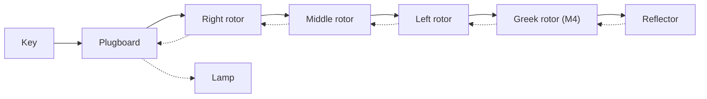

- The right rotor steps on every key press, the middle rotor double-steps, the Greek rotor never steps.
- Every rotor has a ring setting (Ringstellung), Beta and Gamma included.
- Plugboard: 0–13 pairs, each letter in at most one pair.
- An M4 with B-thin + Beta at A, ring A, equals an M3 with reflector B; C-thin + Gamma equals reflector C.

## Architecture

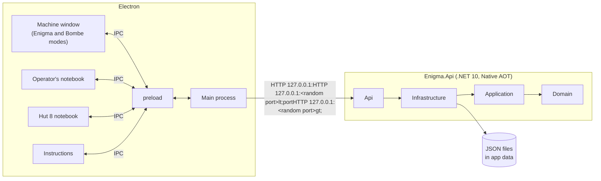

- Main starts `Enigma.Api` as a child process, reads its port from stdout and restarts it on request when it stops.
- All machine logic lives in the backend. The renderers show state and send user actions.
- Each window is the same renderer, selected by its hash (`#notebook`, `#hut8`, `#instructions`). Each has its own Zustand store.
- The renderers run with `contextIsolation` on and `nodeIntegration` off, under a Content Security Policy, as a single instance without navigation, new windows, webviews or permissions.

A call from a renderer, and how other windows stay in step:

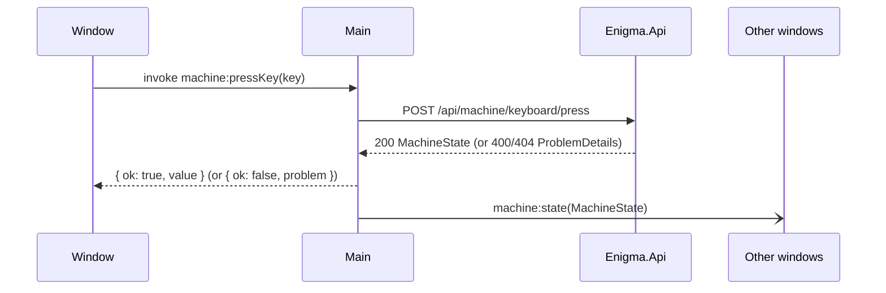

| Channel | Direction | Content |
|---|---|---|
| `machine:*`, `keySheets:*`, `bombe:*` | renderer → main | One channel per API operation. |
| `machine:state` | main → windows | The new machine state. |
| `bombe:result` | main → windows | A Bombe call that changed the job, run or a check, with its result. |
| `keySheets:changed` | main → windows | Key sheets were added or removed. |
| `windows:*` | both | Open a window, show a mode, release a checking machine key. |
| `files:*` | renderer → main | Open, save and print key sheets. |
| `backend:status`, `backend:restart` | both | Backend state; restart after it stops. |

## Backend

### Domain: Machine

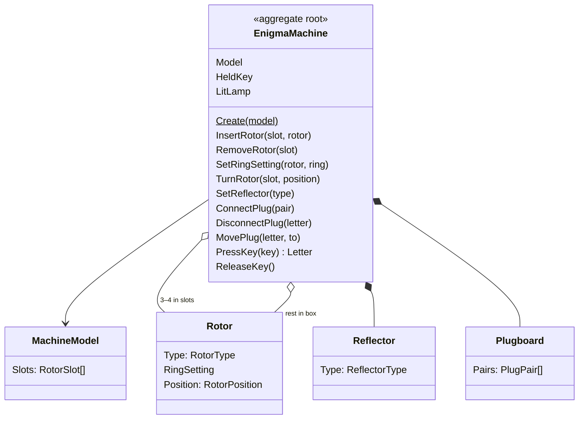

Value objects: `Letter`, `Wiring`, `RingSetting`, `RotorPosition`, `PlugPair`. Events: `RotorsStepped`, `LampLit`.

Invariants:
- Each slot holds at most one rotor, and each rotor type is used at most once. Typing needs every slot filled.
- Beta and Gamma go only in the Greek slot, and only on the M4. The M4 takes a thin reflector; the M3 takes B or C.
- `SetRingSetting` works only on rotors in the box. Each rotor keeps its ring and position in or out of the machine.
- While a key is held, no other key can be pressed and the machine cannot be changed.

`Create(model)` fits I-II-III + B (M3) or Beta-I-II-III + B-thin (M4), rings and positions at A, no plugs. Switching model creates a new machine.

### Domain: Key procedure

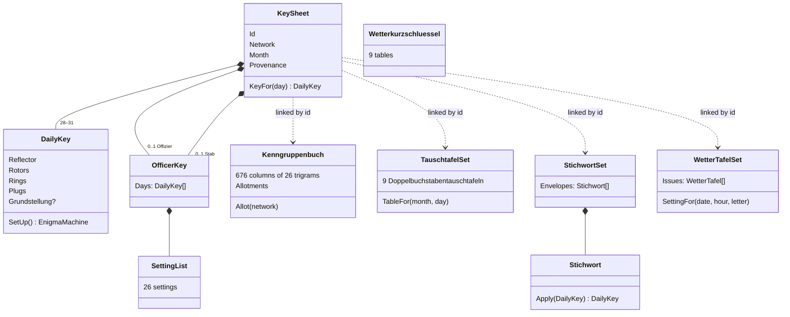

- `Provenance`: `Historical(source)` (read-only), `Generated` or `UserDefined`. A sheet's keys are all for one model.
- `KeySheetGenerator`: a month for one network. The inner setting (reflector, Walzenlage, rings) changes every other day, the 10 plug pairs and the Grundstellung daily. Every Walzenlage includes one of VI–VIII.
- `OfficerKeyGenerator`: the Offizier key uses the day's inner setting with its own plugs every two days; the Stab key has its own inner setting every three days and its own plugs daily.
- `Kenngruppenbuch`: columns 1–100 are allotted to the Verfahrenkenngruppen and 20 columns to each network; `Allot` gives a new network the next 20 free columns.
- `TauschtafelSet`: a year's 9 tables, one per half month (days 1–15, 16–end), cycling.
- `Stichwort.Apply`: changes rotor numbers, rings and plug letters by the Danzig rule (A = 1); the sixth letter is a dummy.
- `WetterTafelSet`: 20.1.42–9.3.43 follow the Weimar, Eisenach and Naumburg issues; otherwise one issue per quarter. Each issue has four six-hour columns.
- `Wetterkurzschluessel`: the 2nd-edition weather short-signal book. Tables 5 and 9 follow Mahon; the others are reconstructed.

The indicator procedure:

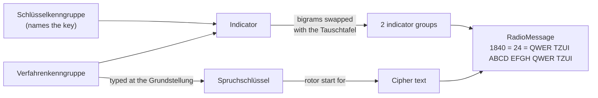

- `Indicator`: the Schlüsselkenngruppe with a filler in front, above the Verfahrenkenngruppe with a filler behind; the vertical bigrams are swapped with the table.
- `MessageKey`: the Grundstellung and the Spruchschlüssel. On the M4 the Greek rotor keeps its Grundstellung letter.
- `RadioMessage`: time of origin, letter count, the 2 indicator groups, the cipher text in groups of 4, the indicator groups again. Parsing also accepts a preamble without separators (`1925 21`).

`OperatorProcedure` guides the operator through sending or receiving:

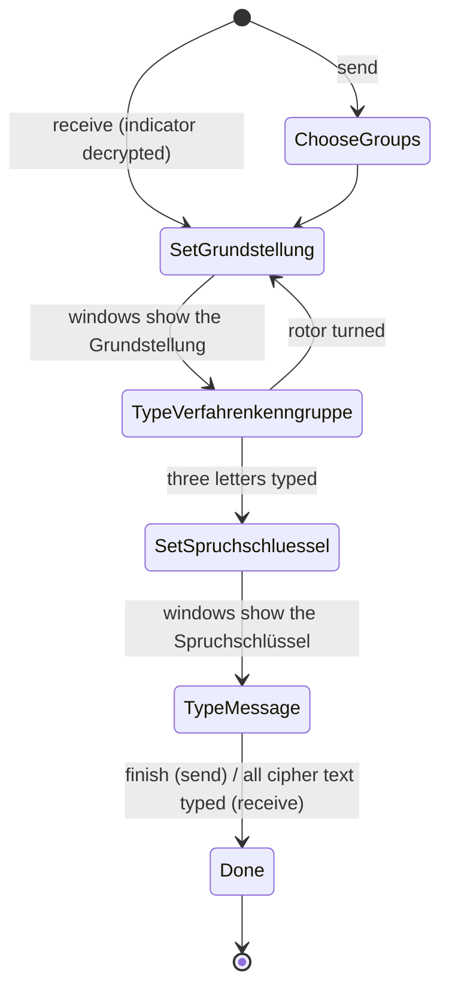

- Keys other than the expected one are rejected, and so is any key outside a typing step.
- Sending finishes once the operator has filled the last group with X.
- Receiving warns when the letter count differs, the Schlüsselkenngruppe is not allotted to the network, or the Verfahrenkenngruppe is not one.

### Application

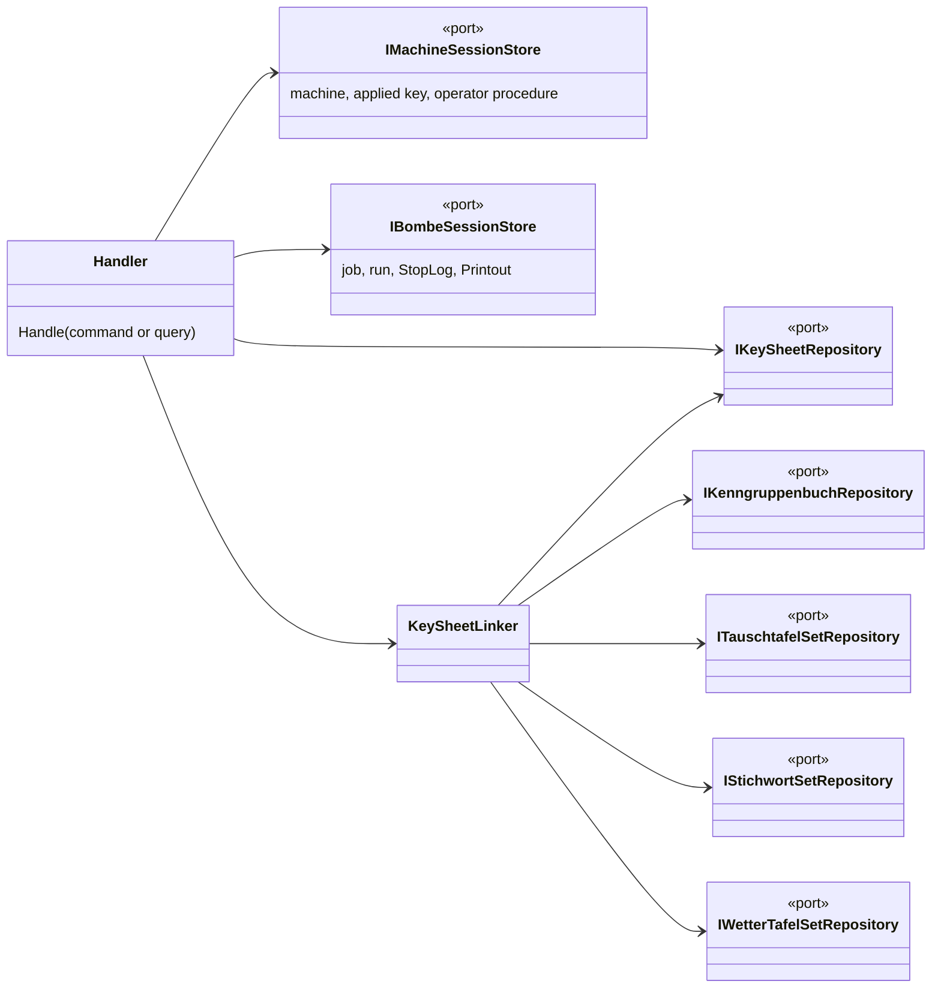

- Each command and query has a plain handler, without a mediator library. Machine and operator commands return the `MachineState`.
- There is one machine. It starts as a default M3.
- `KeySheetLinker` links each sheet when it is saved or loaded: the newest Kenngruppenbuch (allotting columns to a new network, or generating a new book when none are free), and the Tauschtafel set, Stichwort set and weather tables for its year. It generates missing books and sets, random Grundstellungen and missing Offizier and Stab keys.
- `MachineState` includes:
  - `appliedKey`: the sheet, month and day last applied, and `modified` once the reflector, rotor order, rings or plugs differ from it.
  - `operator`: the procedure's direction, step, groups, indicator, keys, the lamps they lit, the radio message and warnings. Applying a key or creating a machine ends it.
  - `lamps`: every lamp lit since they were cleared.
- `GenerateKeySheets` makes every month of a year for each network of the Kenngruppenbuch; it is refused when generated sheets for that model and year exist.
- `FindReceivingKeys` gives the sheets of the month whose network the message's Schlüsselkenngruppe is allotted to.
- Key sheet files (JSON) contain the sheet with its linked book, table set, Stichwort set and weather tables. Imports become user-defined. An allotment that clashes, or a book or set that differs under the same id, rejects the import.

### Infrastructure

| Class | Stores |
|---|---|
| `JsonKeySheetRepository` | Historical sheets, read-only, in `KeySheets:HistoricalPath`. Generated and user-defined sheets, one file each, in `KeySheets:UserPath`. |
| `JsonKenngruppenbuchRepository` | `procedure/books/` under the user path |
| `JsonTauschtafelSetRepository` | `procedure/tables/` |
| `JsonStichwortSetRepository` | `procedure/stichwoerter/` |
| `JsonWetterTafelSetRepository` | `procedure/wettertafeln/` |
| — | `procedure/historical-links.json`: links, Grundstellungen and officer keys of historical sheets |
| `InMemoryMachineSessionStore` | The machine; runs operations on it one at a time. |
| `InMemoryBombeSessionStore` | The Bombe job, run, stop log and printout. |

Electron passes both key sheet paths.

### Api

- ASP.NET Core minimal API, the composition root. Published with Native AOT; JSON uses source generation (`ApiJsonContext`).
- Invariant violations return 400 `ProblemDetails`; unknown key sheets, books, table sets, stops and the like return 404.
- Ring settings are numbers 1–26. Positions, keys and lamps are letters.
- Every endpoint has a tag and a summary. The build writes the OpenAPI document to [`docs/api/enigma-api.json`](api/enigma-api.json).
- The API listens on a random port, or on `Api:Port` when set. In the Development environment (`dotnet run`, `npm start`) it uses port 5174 and serves the OpenAPI document at `http://127.0.0.1:5174/openapi/v1.json`.

## Frontend

- Electron Forge (Vite + TypeScript) with React and SVG components.
- The machine window has a header that switches between Enigma and Bombe mode. Both frames stay mounted; only the active one listens to the physical keyboard.

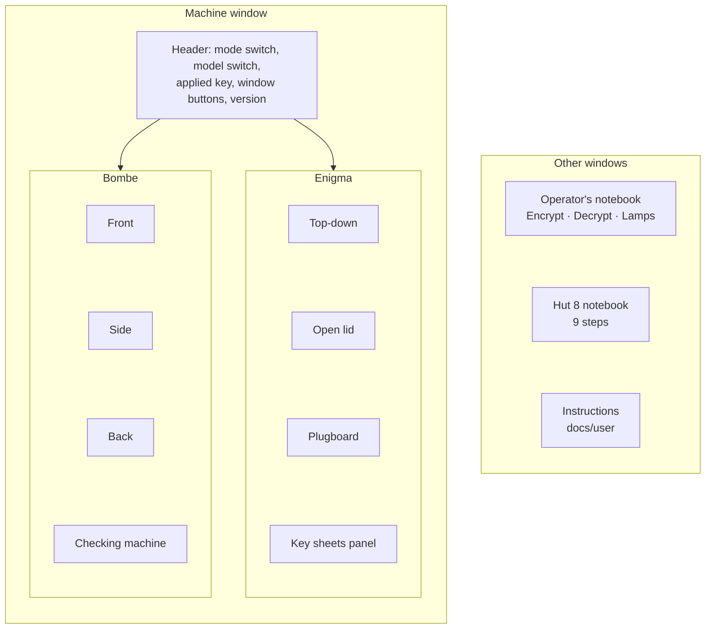

| Part | Shows |
|---|---|
| Top-down | Rotor windows with thumbwheels, lampboard, keyboard. |
| Open lid | The machine from the front, above the rotor box and the reflector box. |
| Plugboard | Sockets in keyboard order with cables. |
| Key sheets panel | Choose, generate, import, export, delete and apply sheets; print them to PDF (`printSheet.ts`). |
| Operator's notebook | The send and receive procedure, handwritten on squared paper, and the lamps lit. |
| Bombe Front | Drum rack, three banks of 12 scramblers, indicator drums and the printout. |
| Bombe Side | Run progress, warnings, test register and controls (diagonal board, reflector, speed, Start/Stop/Continue). |
| Bombe Back | Commons, jacks, test registers and cables per chain; chain joins and input wires. |
| Checking machine | The Hut 8 checking machine, set up for a stop. |
| Hut 8 notebook | The breaking procedure, step by step (see [Bombe](#bombe)). |
| Instructions | The user guide in `docs/user`, rendered with react-markdown. |

Drag-and-drop for plug cables, Bombe drums and cables, and checking machine drums shares `usePlugDrag`. Handwriting uses Kalam, printed sheets Special Elite and Courier Prime (`assets/fonts`).

## Bombe

The three-rotor Turing-Welchman Bombe, as Hut 8 used it against Navy traffic. Banburismus is explained in the user guide, not simulated.

The breaking procedure, as the Hut 8 notebook walks through it:

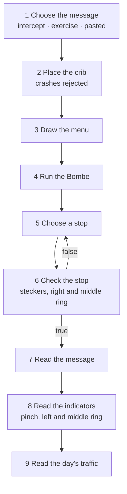

An intercept or bare cipher text ends at step 7.

### Domain: Bombe

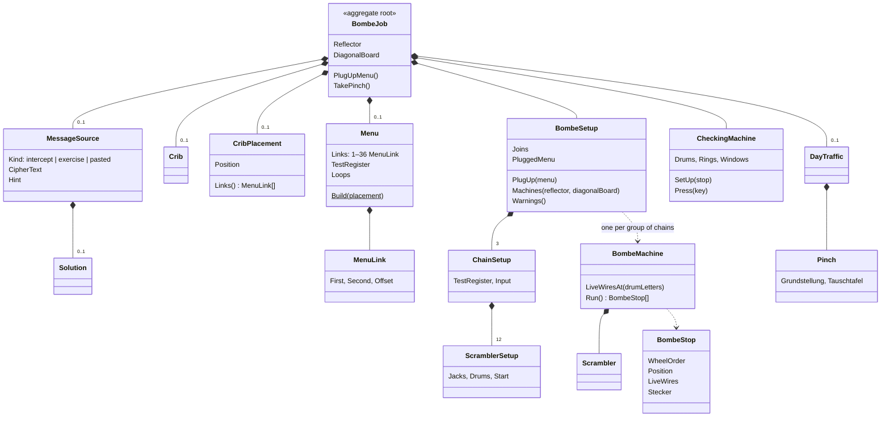

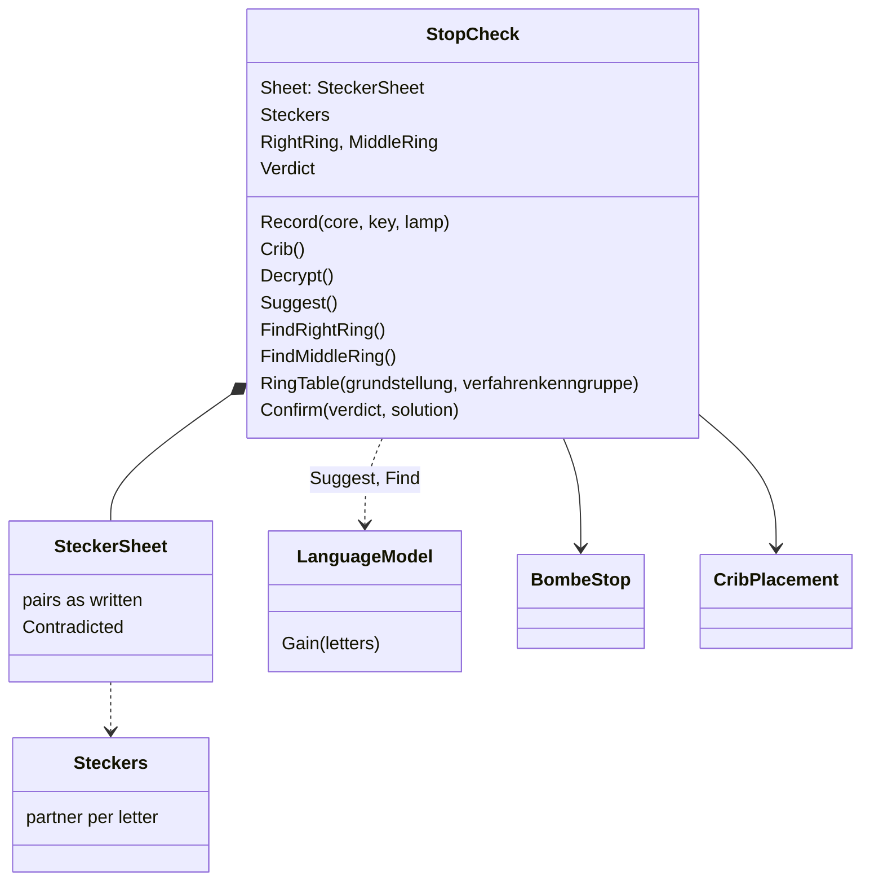

- `WheelOrder`: three distinct rotors of I–VIII; 336 in all.
- `DrumPosition`: core positions (window letter minus ring). Offsets are drum letters from ZZZ (1 = ZZA, 26 = ZAZ); drums advance without carrying.
- Bombe drum letters are ahead of the Enigma rotors: I, II, III, VI, VII and VIII by one letter, IV by two, V by three. The indicator plus the offsets gives the rings for windows ZZZ.
- `Scrambler`: a double-ended Enigma (rotors and reflector B or C, no plugboard) at a drum position, as a precomputed table.
- `CribPlacement`: a crib letter under the same cipher letter is a crash; a crashed placement has no links.
- `Menu`:
  - `Loops` = links − letters + 1 for the part connected to the test register.
  - `EstimatedStops(diagonalBoard)` = 17,576 × (1 − e^−λ), λ = 26^(1 − loops), times (600/676)^(letter pairs) with the diagonal board.
  - `Create` puts the test register on the letter with the most links, then the most loops through it, then A–Z.
  - `Build` takes the connected part with the fewest estimated stops on one chain. Above 12 links it drops chain-end links first, then links on loops.
  - A menu of up to 12 links runs as 3 copies, longer menus as 1 copy over joined chains.
- `MeasuredStops`: runs a menu on six seeded wheel orders and reflectors, with and without the diagonal board, and gives the average stops per wheel order.
- `BombeMachine`: 26 wires per letter. A scrambler joins wire x of one letter's cable to wire scrambler(x) of the other; the diagonal board joins wire b of cable a to wire a of cable b. A position stops unless all 26 test register wires are live. `Run()` tests all 17,576 positions, the upper drum fastest.
- `BombeStop.Stecker`: the only live wire, or the only dead one when 25 are live.
- `CheckingMachine`: three drums with Bombe drum letters, rings and windows, no plugboard, no stepping. `SetUp(stop)` puts the rings at the stop's indicator and the windows at ZZZ.
- `StopCheck`:
  - `Record` writes a lamp as the partner of a crib link letter. The sheet keeps contradictions; `Steckers` keeps the pairs without one.
  - `Suggest` proposes partners for unknown letters that keep every crib link consistent, scored by the language model's gain, up to ten plug pairs.
  - `FindRightRing` and `FindMiddleRing` score the decrypt for each of the 26 rings with the core positions kept, and set the best.
  - `RingTable` gives, for each left and middle ring, the Spruchschlüssel and the cores it steps to at the crib. The row that matches the stop has the rings.
- `LanguageModel`: the log probability of each letter after the two before it (0.6 trigram + 0.3 bigram + 0.1 letter, half Navy, half German). `scripts/LanguageTable.cs` writes `LanguageCounts` from the intercepts, exercise texts and `data/corpus/effi-briest.txt`, converted to Navy style.
- `Intercepts`: compiled in, each verified against its published key: Scharnhorst's last signal, both parts of the Operation Barbarossa message and Carter's weather crib.
- `ExerciseGenerator`: a Navy message from a template, sent on an M3 key sheet day with the full procedure. It retries the message key until the middle rotor does not turn over under the crib, the menu has at least 2 loops and a decoy crib position exists. `DayTraffic` adds 3–5 other messages for the same day.

### Application: Bombe

A run turns the drums once through all 17,576 positions in the background:

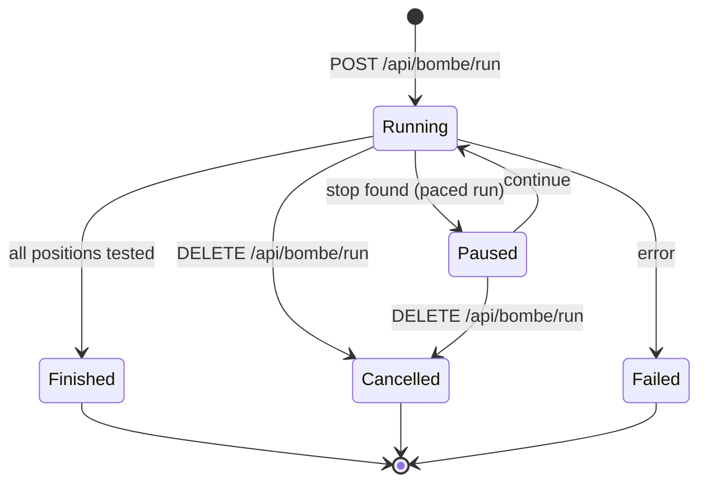

- The speed is in positions per second, or full speed (groups in parallel; a run at full speed does not pause at stops). `HistoricalSpeed` (28.2/s) runs without stops in 10.4 minutes. The speed can change during a run.
- Every stop goes to the `Printout`. When the run is started from the notebook and the Bombe is plugged up with the job's menu, stops also go to the `StopLog`, each with a `StopCheck` started when first asked for.
- Changing the message, crib or menu clears the stop log. Changing the job is refused while a run is going or paused.
- Stops and the printout are fetched in pages, as a poor menu can give hundreds of thousands.
- The machine window polls the run (every 100 ms when paced, 250 ms at full speed); the notebook follows the results.
- `GenerateExercise` uses a random M3 key sheet day with rotor I–V on the right. The state never contains a crib or solution; they are fetched on request.

## Testing

- **Backend:** xUnit, in `Enigma.Domain.Tests`, `Enigma.Application.Tests` and `Enigma.Api.Tests` (`WebApplicationFactory`, with only the source-generated JSON contexts).
- Historical vectors include the U-264 message and Carter's weather crib: exactly 2 stops with the diagonal board, the true one at core positions VMB with G/Q, indicator DKX. The bundled intercepts decrypt to their published plain text.
- **Frontend:** Vitest + React Testing Library, plus Playwright end-to-end tests against the packaged app.

## Build and release

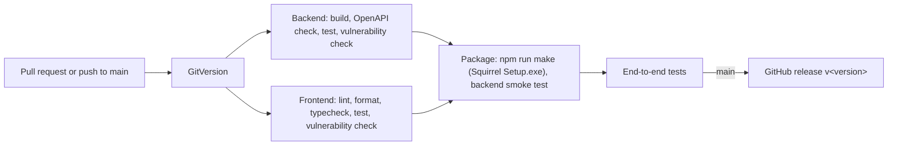

- GitVersion (GitHubFlow, Conventional Commits) sets the version.
- Static analysis: .NET analyzers with warnings as errors, ESLint, and NuGet and npm vulnerability checks.
- CI fails when the committed OpenAPI document differs from the built one.
- Packaging runs as a matrix over operating systems; Windows only for now.
- Artifacts from `main` are kept for 7 days. PR artifacts are deleted when the PR closes.

## Repository layout

```
src/backend/{Enigma.Domain, Enigma.Application, Enigma.Infrastructure, Enigma.Api}
src/frontend/
tests/{Enigma.Domain.Tests, Enigma.Application.Tests, Enigma.Api.Tests}
data/{keysheets/, corpus/}
scripts/
docs/{design.md, api/, user/}
.github/workflows/
```
